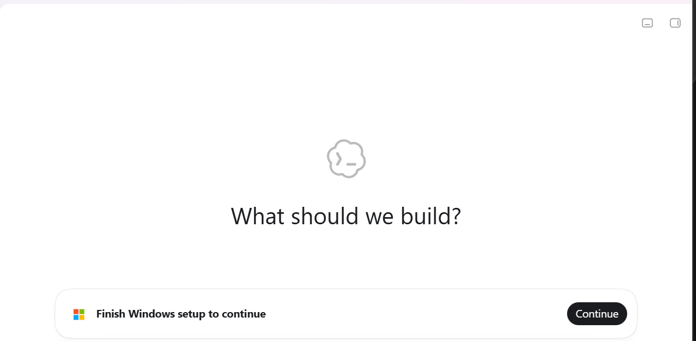
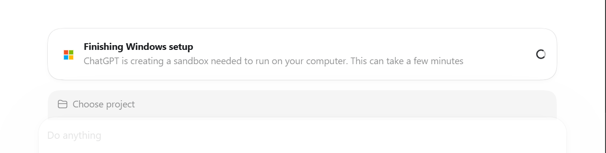
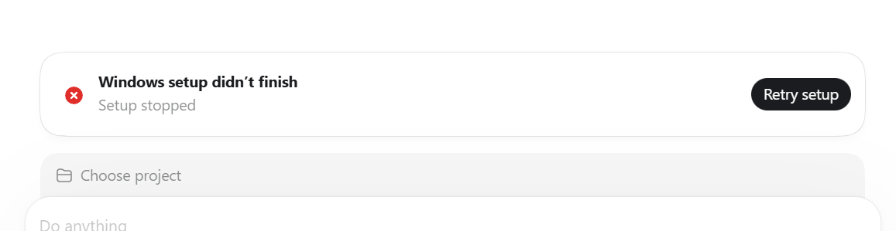
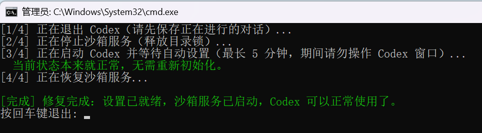
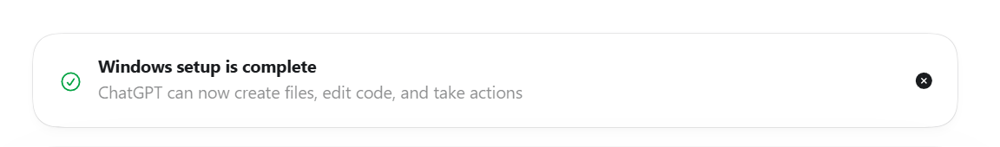

# Codex Windows 设置修复（Codex Windows Setup Fix）

[← English](README.md)

Codex 桌面版（OpenAI，Windows）有一个非常坑人的 bug：首次运行的 "Windows 设置" 永远失败，横幅停在 **"Windows setup didn't finish — Setup stopped"**，而 **「重试设置」按钮永远修不好**。本文是完整的排查记录，并提供**一键修复脚本**。

> **状态：** 社区临时方案（workaround），于 **2026 年 10 月、Windows 11、Codex 桌面版 v26.1007.x**（MSIX 包 `OpenAI.Codex`）上验证通过。根因在应用自身：它的沙箱初始化程序和它自己的开机自启服务抢同一把锁。等 OpenAI 上游修复后，本仓库将归档——想追踪进展可以点 Star / Watch。

## 症状

Codex 桌面应用内的横幅会依次经历三个状态：

| 1. 要求完成设置 | 2. 正在设置（转几分钟） | 3. 失败——无限循环 |
|---|---|---|
|  |  |  |

识别特征：

- 第二阶段（"creating a sandbox…"）转几分钟后必然变成第三阶段；
- **点「重试设置」永远再次失败**——那个按钮救不了你；
- 重启电脑也没用；
- 通常**从应用更新之后开始出现**。

## 根因

Windows 版 Codex 桌面应用在首次启动时要初始化一个沙箱（此后凡是初始化状态失效——最常见于**应用更新之后**——都会重新初始化）。执行初始化的程序 `codex-windows-sandbox-setup.exe` 需要**独占锁定目录** `C:\Users\<你的用户名>\.codex\.sandbox-bin`。

而这个应用自带一个 Windows 服务——**`CodexSandboxService.OpenAI.Codex`**（显示名 *"ChatGPT"*，启动类型 **自动**，以 `LocalSystem` 运行）——只要它在开机后启动，就一直持有这个目录的句柄。

于是，只要应用需要（重新）跑初始化而服务又在运行，就必然失败，日志里留下：

```text
setup error: helper_sandbox_lock_failed: lock sandbox bin dir
\\?\C:\Users\<你的用户名>\.codex\.sandbox-bin failed: open directory
\\?\C:\Users\<你的用户名>\.codex\.sandbox-bin
```

应用内的**「重试设置」只会重新调用这个失败的程序，永远不会去停服务**——所以永远修不好。这就是陷阱所在：*修复需要停掉的，恰恰是应用自己开机拉起的那个服务。*

## 修复方法

### 方案 A：一键脚本（推荐）

1. 从本仓库下载 [`scripts/`](scripts/) 文件夹（**三个文件要放在同一目录**）；
2. 双击 **`Fix-Codex-Setup.cmd`**；
3. 在 UAC 弹窗点**「是」**（停服务需要管理员权限）；
4. 等绿色的 **`[DONE]`** 行出现——通常 1~3 分钟：



**把工具装到桌面并配上图标**（可选，在仓库根目录执行一条命令）：

```powershell
powershell -NoProfile -ExecutionPolicy Bypass -File scripts\Install-To-Desktop.ps1
```

会在你的桌面创建带自定义图标（蓝色圆角块 + 白色扳手 + 绿色对勾）的 **`Fix-Codex-Setup`** 快捷方式。装完后请**保持仓库文件夹位置不变**——快捷方式指向它。如果桌面上已经有一个原始的 `Fix-Codex-Setup.cmd` 文件，可以删掉，快捷方式代替了它。

脚本做的事（所有步骤幂等，随时可重复运行）：

| 步骤 | 动作 | 目的 |
|---|---|---|
| 1/4 | 退出 Codex（`ChatGPT.exe`、`codex.exe`、残留的 setup 进程） | 应用需要重启后初始化才会重跑 |
| 2/4 | `Stop-Service CodexSandboxService.OpenAI.Codex` | 释放 `sandbox-bin` 目录锁 |
| 3/4 | 重新启动应用并轮询（最长 5 分钟） | 没有锁之后初始化会自己成功；脚本监视 `setup_marker.json` / `setup_error.json` |
| 4/4 | 再次 `Start-Service` 沙箱服务 | 恢复沙箱正常运行 |

如果你的状态本来就正常，脚本会检测到并提示「无需重新初始化」，不改变任何东西直接退出。

> 不想跑陌生脚本？用方案 B，手动流程和脚本完全一致。

### 方案 B：手动四步

```powershell
# 1. 完全退出应用：右键任务栏图标 -> 退出，
#    或在任务管理器结束 "ChatGPT.exe" / "codex.exe" 进程。

# 2. 在【管理员】PowerShell 中执行：
Stop-Service CodexSandboxService.OpenAI.Codex -Force

# 3. 从开始菜单重新打开应用。
#    初始化会自动跑完（几秒钟），不需要点「重试」。

# 4. 验证成功（见下节）后，恢复服务：
Start-Service CodexSandboxService.OpenAI.Codex
```

## 怎么确认修好了

- 应用里出现绿色横幅：**"Windows setup is complete — ChatGPT can now create files, edit code, and take actions"**

  

- 磁盘上三个文件相互印证：

| 文件 | 修复前（故障） | 修复后（正常） |
|---|---|---|
| `~\.codex\.sandbox\setup_marker.json` | 0 字节 | 非空 JSON，如 `{"version": 5, ...}` |
| `~\.codex\.sandbox\setup_error.json` | 存有 `helper_sandbox_lock_failed` 错误 | 已清空 |
| `~\.codex\.sandbox\sandbox-*.log`（最新） | 结尾是 `setup error: helper_sandbox_lock_failed` | 无此错误 |

成功标记（`setup_marker.json`）示例：

```json
{
  "version": 5,
  "offline_username": "CodexSandboxOffline",
  "online_username": "CodexSandboxOnline",
  "created_at": "2026-10-14T03:10:55.939412+00:00",
  "proxy_ports": [],
  "allow_local_binding": false,
  "read_roots": [],
  "write_roots": []
}
```

## 技术细节

### 证据：占锁的就是那个服务

同一台机器、同一版本应用的对照实验（Windows 11，Codex v26.1007.x，2026-10-14）：

| 时间 | 沙箱服务状态 | 操作 | 结果 |
|---|---|---|---|
| 08:36 | 运行中（开机自启） | 开机后应用自动启动，触发初始化 | 生成 guard 文件后失败 |
| 10:49 | 运行中 | 用户点「重试设置」 | ❌ `helper_sandbox_lock_failed` |
| 11:03 | 运行中 | 用户再点「重试设置」 | ❌ `helper_sandbox_lock_failed` |
| 11:10 | **已停止** | 重新启动应用 | ✅ 数秒内完成，marker 写入 |
| 11:14 | 手动恢复运行 | — | 正常使用 |
| 12:18 | 由本仓库脚本停/启 | 脚本端到端实测 | ✅ 通过 |

唯一改变结果的变量，就是服务是否在运行。

### 关键位置一览

| 项目 | 位置 |
|---|---|
| 应用包（MSIX） | `OpenAI.Codex`——界面进程叫 `ChatGPT.exe`，AUMID 为 `OpenAI.Codex_2p2nqsd0c76g0!App` |
| 沙箱服务 | `CodexSandboxService.OpenAI.Codex`，显示名 *"ChatGPT"*，启动类型 自动，二进制 `codex-windows-sandbox-service.exe` 在包目录内 |
| 初始化程序 | `codex-windows-sandbox-setup.exe`（初始化时被拉起） |
| 状态目录 | `%USERPROFILE%\.codex\`——`.sandbox\` 内有 `setup_marker.json`、`setup_error.json`、`sandbox-*.log` |
| 被抢锁的目录 | `%USERPROFILE%\.codex\.sandbox-bin` |
| 初始化 guard | `%USERPROFILE%\.codex\.codex-provisioning-<id>.guard` |

### 相关发现：为什么它每次开机都自启

同一个 MSIX 包在清单里声明了启动任务：

```xml
<uap5:Extension Category="windows.startupTask" Executable="app/ChatGPT.exe" ...>
  <uap5:StartupTask TaskId="App" Enabled="true" DisplayName="ChatGPT" />
```

所以**这个应用开机自启时，显示的名字是 "ChatGPT"**（任务管理器 → 启动应用），而不是 "Codex"——非常容易被忽略。再叠加那个自动启动的服务，就是"更新后第二天开机就撞上失败"的原因。不需要开机自启的话，在任务管理器里禁用该条目即可，不影响本修复方案。

## 常见问题

**Q：为什么「重试设置」永远没用？**
它只是重新调用那个注定失败的程序，锁还在服务手里。必须先停服务（用本仓库脚本或方案 B）。

**Q：以后还会复发吗？**
大概率会——只要初始化状态再次失效（最常见是应用更新后重新初始化）。把这个仓库收藏好，复发时重跑脚本即可，脚本幂等。

**Q：脚本安全吗？动了我系统的什么？**
只动 OpenAI.Codex 自己的东西：结束 `ChatGPT.exe` / `codex.exe` / `codex-windows-sandbox-setup.exe` 进程、**只**停/启它自己的服务 `CodexSandboxService.OpenAI.Codex`、读取并删除它自己的 `setup_error.json`。不碰系统其他任何东西。完整源码在 [`scripts/fix-codex-setup.ps1`](scripts/fix-codex-setup.ps1)，约 80 行，可自行审阅。

**Q：停了服务还是失败怎么办？**
欢迎开 issue，附上你的 Windows 版本（winver）、Codex 版本、最新 `sandbox-*.log` 的末尾几行。不同机器的占锁者可能不同（比如杀毒软件），日志会写明失败在哪一步。

## 让 AI 助手帮你部署

不想手动折腾？把本仓库克隆到本地后，大多数编程 Agent（Codex CLI、Cursor、Claude Code、GitHub Copilot 等）会**自动读取仓库根目录的 [`AGENTS.md`](AGENTS.md)**——里面是经过实测的分步指令：怎么装桌面快捷方式、怎么跑修复、怎么验证成功，以及 Agent **不许碰什么**（安全边界都写死了）。

直接把下面的提示词粘给你的 AI：

**只部署（不跑修复、不改动 Codex 本身）：**

```text
我刚克隆了 Codex-windows-setup-fix 这个仓库。请阅读它的 AGENTS.md 并执行任务 A：
把修复工具以带自定义图标的快捷方式安装到我的桌面上，验证快捷方式创建成功，
然后告诉我当 Codex 桌面版出现 "Windows setup didn't finish" 横幅时该怎么用。
如果弹出 UAC，我会点“是”。
```

**现在就修（看到故障横幅时用这个）：**

```text
我刚克隆了 Codex-windows-setup-fix 这个仓库。请阅读它的 AGENTS.md 并执行任务 B：
先告诉我将要发生什么，然后立刻在我机器上运行修复，等到绿色 [DONE] 行出现后，
验证 setup_marker.json 和 setup_error.json。UAC 弹窗我会点“是”。
```

即使你的 Agent 不会自动读 `AGENTS.md` 也没关系——提示词里让它去读，它照做即可。

## 反馈与贡献

欢迎开 issue——复现报告能帮助确认问题的普遍程度。提 issue 时请附：

- Windows 版本（`winver`）和 Codex 桌面版版本（MSIX 包 `OpenAI.Codex` 的版本号）；
- 你看到的是哪个阶段的横幅、用了脚本还是手动步骤；
- 最新 `~\.codex\.sandbox\sandbox-*.log` 末尾约 30 行，以及 `setup_error.json` 的内容——**请先把用户名/路径脱敏**。

## 免责声明与许可证

风险自负。脚本只操作 OpenAI.Codex 应用自己的进程和它自己的 Windows 服务；上述流程在一台机器上验证通过（见上文），其他环境不保证有效。本仓库与 OpenAI 无任何关联，也未获其背书。建议同时把该 bug 反馈给 OpenAI——上游修复才是真正的根治。

采用 [MIT License](LICENSE) 开源。
